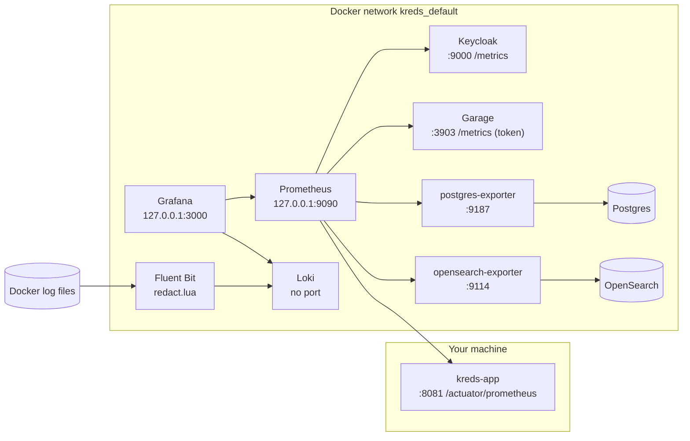

# Monitoring

How Kreds watches itself: metrics, health, logs and (later) alerts – **without ever seeing what users share**.
Decisions: ADR-0003 (Prometheus for metrics, Grafana for dashboards and alerts) and ADR-0004 (Loki for logs).
What each service logs and where personal data hides: [log-inventory.md](log-inventory.md).

## Overview



Prometheus **pulls** ("scrapes") every 30 seconds and keeps metrics for 15 days. Grafana reads from Prometheus and is
the only monitoring UI with a login.

| Job          | Target                                          | Reachable from                                                                        | Access                                                                   |
|--------------|-------------------------------------------------|---------------------------------------------------------------------------------------|--------------------------------------------------------------------------|
| `prometheus` | `localhost:9090`                                | `127.0.0.1:9090` on the host                                                          | Local only                                                               |
| `keycloak`   | `keycloak:9000/metrics`                         | Docker network only (management port is **never** published)                          | –                                                                        |
| `garage`     | `garage:3903/metrics`                           | Docker network; admin port also on `127.0.0.1:3903`                                   | Bearer token `GARAGE_METRICS_TOKEN` (metrics only – not the admin token) |
| `postgres`   | `postgres-exporter:9187`                        | Docker network only                                                                   | Exporter logs in as role `monitoring`                                    |
| `opensearch` | `opensearch-exporter:9114`                      | Docker network only                                                                   | None yet (OpenSearch security is off locally)                            |
| `kreds-app`  | `host.docker.internal:8081/actuator/prometheus` | Management port of the app, bound to `KREDS_MANAGEMENT_ADDRESS` (default `127.0.0.1`) | None – the port is never public                                          |
| `loki`       | `loki:3100/metrics`                             | Docker network only                                                                   | –                                                                        |
| `fluent-bit` | `fluent-bit:2020/api/v2/metrics/prometheus`     | Docker network only                                                                   | –                                                                        |

## Starting and stopping

Monitoring lives in its own file, `docker-compose.monitoring.yml`, in the **same Compose project** (`name: kreds`),
so it shares the network with the services it watches.

```bash
# Everything
docker compose -f docker-compose.yml -f docker-compose.monitoring.yml up -d

# Kreds only (Compose then warns about "orphan containers" – harmless, never add --remove-orphans)
docker compose up -d

# Check the scrape config before (re)starting Prometheus
docker compose -f docker-compose.yml -f docker-compose.monitoring.yml run --rm --entrypoint promtool prometheus check config /etc/prometheus/prometheus.yml

# After changing prometheus.yml
docker compose -f docker-compose.yml -f docker-compose.monitoring.yml restart prometheus
```

> **Never use `docker compose down -v`** unless you want to wipe all data. `-v` deletes the volumes – Postgres,
> OpenSearch, Garage (including its layout, bucket and keys) and Prometheus.

Status page: `http://127.0.0.1:9090/targets` – every job must be **UP**.

## Grafana

`http://127.0.0.1:3000` – log in with `GRAFANA_ADMIN_USER` / `GRAFANA_ADMIN_PASSWORD` from `.env`.

- **OSS image** `grafana/grafana` (AGPL-3.0) – never `grafana-enterprise` (different licence). Pin a stable
  `MAJOR.MINOR.PATCH` tag, never a nightly build (a tag with a long build number after the hyphen).
- **Locked down:** no anonymous access, no sign-up, admin password as a Compose secret
  (`GF_SECURITY_ADMIN_PASSWORD__FILE`).
- **Nothing leaves the machine:** usage reporting, update checks, news feed and Gravatar are switched off.
- **The admin password is applied only on the very first start** (when `grafana-data` is empty). To change it later:
  `docker exec kreds-grafana grafana cli admin reset-admin-password <new>`.

Everything is **provisioned as code** from `monitoring/grafana/`:

| File                                      | What                                                                                                                                              |
|-------------------------------------------|---------------------------------------------------------------------------------------------------------------------------------------------------|
| `provisioning/datasources/prometheus.yml` | Data source `Prometheus` with the fixed uid `prometheus`; not editable in the UI                                                                  |
| `provisioning/dashboards/kreds.yml`       | Loads every JSON file from `dashboards/` into the folder *Kreds*; UI changes cannot be saved                                                      |
| `dashboards/kreds-overview.json`          | **"Kreds – is it OK?"** – services up, Postgres reachable, OpenSearch not red, logins per hour, app requests and errors, JVM heap, database sizes |
| `dashboards/kreds-logs.json`              | **"Kreds – logs"** – dropdowns for service and level, log lines per service, errors and warnings, the log lines themselves                        |

**Changing a dashboard:** edit it in the UI to try things out, then *Export → Export as JSON*, replace the file in
`dashboards/`, and discard the UI changes. Grafana reloads the file within 30 seconds. Every panel must use the data
source uid `prometheus` – an exported dashboard from another Grafana may carry a different one.

## Logs (Fluent Bit → Loki)

```
container → Docker log file → Fluent Bit (allow list, redact.lua) → Loki → Grafana
```

- **Docker** writes every container's output to a JSON log file (rotated: 10 MB × 3). The shared logging block copies
  the container label `kreds.service` into every line, so Fluent Bit knows which service wrote it.
- **Fluent Bit** (`monitoring/fluent-bit/`) is the **one filter point** – personal data is removed here, before
  anything is stored:
    - **Allow list:** only services named in `fluent-bit.yaml` are shipped. A new service sends nothing until it is
      added – after checking its logs for personal data (`log-inventory.md`).
    - **`redact.lua`:** removes Keycloak's `username`, `ipAddress`, `code_id` and IP addresses; drops Postgres'
      `STATEMENT:` and `DETAIL:` lines; replaces every email address in every service with `[email removed]`.
    - Keeps only the log text; labels are `service` and `env` (`KREDS_ENV`, `local` here). Fluent Bit's own logs are
      never shipped (no label – no loop).
    - Runs as **root**, because Docker's log folder is readable only by root. Mitigation: read-only mount, no ports.
- **Loki** stores the lines for **14 days** (compactor retention), has **no port and no login** (ADR-0004), and its
  usage reporting to Grafana Labs is **off** (`analytics.reporting_enabled: false`). A one-shot `loki-init` container
  (BusyBox) hands the data volume to Loki's unprivileged user `10001`.
- **Labels and levels:**
    - `service` and `env` are our own labels (set by Fluent Bit). Loki's automatic copy `service_name` is switched off
      (`discover_service_name: []`) – it would only duplicate `service`.
    - `detected_level` is added by Loki (`discover_log_levels: true`): the level found in each line, **normalised** to
      `debug` / `info` / `warn` / `error` (or `unknown`) – one filter for every log format (Keycloak `WARN`, Postgres
      `ERROR:`, Grafana `level=info`). It is structured metadata, not a label, so it costs no extra streams.
    - The `level` Grafana shows in a line's details is just read from the line text – nothing stored.
- **Grafana** reads Loki through the provisioned data source (uid `loki`). The dashboard **"Kreds – logs"** has
  dropdowns for service and level; **Explore** is the place for free LogQL, e.g.:

```
{service="keycloak"} |= "LOGIN_ERROR"                       # failed logins (without usernames)
{service=~"keycloak|postgres"} | detected_level="error"     # errors of both filtered services
sum by (service) (count_over_time({service=~".+"}[5m]))     # lines per service
```

**Testing the filter – with fake data only.** Never test redaction by sending real personal data to Loki:

```bash
monitoring/fluent-bit/test/run-redact-test.sh
```

It runs `redact.lua` on `test/samples.log` (fake lines) in a throwaway container and fails if any personal data
survives – or if useful information (`LOGIN_ERROR`, `user_not_found`, Postgres `ERROR:`) is lost. `samples.log` is
explicitly allowed in `.gitignore` (`*.log` is ignored otherwise).

**Adding a service to the logs:** label it (`kreds.service`), look at its real output, extend `redact.lua` and
`samples.log` if needed, run the test, then add it to the allow list.

## App logs (Spring Boot)

What the Kreds app itself writes – ready for Loki, shipped once the app runs as a container.

- **Format:** readable text in the IDE. **JSON** (Logstash layout, one object per line) when
  `LOGGING_STRUCTURED_FORMAT_CONSOLE=logstash` is set – in containers and on the server. The top-level `level` field
  becomes Loki's `detected_level`. `StructuredLoggingIT` fixes this contract (`level`, `message`, `@timestamp`).
- **Correlation ID:** `CorrelationIdFilter` gives every request an ID – in every log line of that request
  (`correlationId`), in the response header `X-Correlation-Id`, and in error bodies. A client may send its own ID
  (letters, digits, hyphens, 8–64 characters); anything else is replaced, so nobody can forge log lines.
  Find a request in Grafana: `{service="kreds-app"} | json | correlationId="<id>"`.
- **Errors:** `ApiExceptionHandler` turns every error into **Problem Details** (`application/problem+json`) with a
  stable `code` (`not_found`, `internal_error`, …), the `correlationId` and a calm, generic `detail`. The real cause
  of an unexpected error goes only into the log (`ERROR`, with stack trace, same `correlationId`). Spring Security's
  `401`/`403` have no body yet, but carry the header.
- **Levels:** `INFO` by default for everything (`application.properties`, proven by `LogLevelsIT`).
  `DEBUG` only on purpose, for one package, through an environment variable and a restart:
  `LOGGING_LEVEL_DK_NORDICS_KREDS=DEBUG` (proven by `DebugOverrideIT`). **Never `TRACE` on a server** – DEBUG and
  TRACE are where request details end up.
- **Privacy:** never log content, keys, tokens, passwords or email addresses – at any level. Stack traces can
  contain library messages with values (e.g. SQL); `redact.lua` replaces every email address in every service as
  the last line of defence once `kreds-app` is on the Fluent Bit allow list.

## Secrets and roles

| Variable (`.env`)        | Used by                                                                           | Rights                                                                                          |
|--------------------------|-----------------------------------------------------------------------------------|-------------------------------------------------------------------------------------------------|
| `GARAGE_METRICS_TOKEN`   | Garage + Prometheus (as Compose secret, file `/run/secrets/garage_metrics_token`) | Only `/metrics` – cannot touch buckets or keys                                                  |
| `GRAFANA_ADMIN_PASSWORD` | Grafana (Compose secret, first start only)                                        | Admin of the monitoring UI                                                                      |
| `MONITORING_DB_PASSWORD` | Postgres role `monitoring` + postgres-exporter (Compose secret)                   | `pg_monitor`: statistics and settings; **no** `CONNECT` on the `kreds` and `keycloak` databases |

Secrets reach containers as **Compose secrets** (files under `/run/secrets/`), not as environment variables, so they
do not appear in `docker inspect`. No committed file contains a secret.

The role `monitoring` is created by `postgres/init/20-create-monitoring-role.sh` – automatically on the first start
of an empty volume. For an existing volume, run it once by hand (it is idempotent):

```bash
docker compose exec postgres bash /docker-entrypoint-initdb.d/20-create-monitoring-role.sh
```

## The Kreds app (Spring Boot Actuator)

- Actuator runs on its **own management port** (`KREDS_MANAGEMENT_PORT`, default `8081`), bound to
  `KREDS_MANAGEMENT_ADDRESS` (default `127.0.0.1`). The public API port `8080` serves no Actuator at all.
- Only `health` (including `health/liveness` and `health/readiness`) and `prometheus` are exposed and open without
  a token. Everything else under `/actuator` is denied (`ManagementSecurityConfig`) – `env` or `heapdump` could
  contain secrets.
- `ManagementEndpointsIT` proves all of this.
- **Linux:** `host.docker.internal` points to the Docker bridge (`docker0`), not to `127.0.0.1`. Two things are needed:
    1. Start the app with `KREDS_MANAGEMENT_ADDRESS=172.17.0.1` (in IntelliJ: run configuration → environment
       variables). `172.17.0.1` is Docker's default `docker0` address – check with `ip -4 addr show docker0` and
       `docker exec kreds-prometheus grep host.docker.internal /etc/hosts`; both must show the same IP.
    2. If the Ubuntu firewall (`ufw`) is on, allow **only** Docker's networks to reach the port – never disable the
       firewall:
       ```bash
       sudo ufw allow from 172.16.0.0/12 to any port 8081 proto tcp comment 'Prometheus in Docker -> kreds-app metrics'
       ```
  Symptoms in the targets check: `connection refused` → the app listens on the wrong address;
  `context deadline exceeded` → the firewall drops the connection.
  On macOS, Docker Desktop forwards `host.docker.internal` to `127.0.0.1`, so the default works.
- Later, when the app runs in Compose, the target becomes `kreds-app:8081`, `KREDS_MANAGEMENT_ADDRESS=0.0.0.0`
  (inside a container that means only the container's own network) and the port is not published at all.

## Privacy rules for metrics

The data classification applies to metrics too ("when in doubt, encrypt"):

1. **Labels never contain personal data** – no user IDs, *kreds* IDs, email addresses, IPs or paths. Keycloak's
   login events are labelled only by realm, client, event and error (`KC_EVENT_METRICS_USER_TAGS=realm,clientId`).
2. **Index names never contain personal or *kreds*-specific data** (never `places-<circleId>`). They become label
   values in Prometheus.
3. **Spring metrics use URI templates** (`/api/v1/circles/{id}`), never real IDs, as tags.
4. Bruno checks enforce rule 1 for Keycloak, Garage, Postgres and OpenSearch (allow-list of label names, no `@` in
   label values).

## Checks (Bruno)

**PromQL and LogQL queries go into Bruno's URL field as plain text** (`?query={env="local"}&limit=1000&since=1h`) –
Bruno encodes them itself. Pre-encoded URLs (`%7B...`) or the Params tab lose the query.

Grafana credentials live in a Bruno environment as **secret variables** (`grafanaUser`, `grafanaPassword`) – never
in a request file. A failing targets check names the job, its URL and Prometheus' `lastError`.

| Request                                                               | What it proves                                                                                                       |
|-----------------------------------------------------------------------|----------------------------------------------------------------------------------------------------------------------|
| `GET :9090/api/v1/targets`                                            | All expected jobs exist and are `up`                                                                                 |
| `query=keycloak_user_events_total`                                    | Login events are counted; label names only from the allow-list                                                       |
| `GET :3903/metrics` (no token)                                        | Garage refuses metrics without the token (`401`/`403`)                                                               |
| `query={job="garage"}`                                                | No `@` in any label value                                                                                            |
| `query=pg_up`                                                         | The exporter can really log in to Postgres (`"1"`)                                                                   |
| `query=elasticsearch_cluster_health_number_of_nodes`                  | The exporter really reaches OpenSearch                                                                               |
| `query=elasticsearch_cluster_health_status`                           | Cluster is not red (picked by the `color` label, never by position)                                                  |
| `GET :3000/api/health`                                                | Grafana runs and its database is OK                                                                                  |
| `GET :3000/api/datasources/uid/prometheus/health` (Basic auth)        | Grafana itself can query Prometheus                                                                                  |
| `GET :3000/api/datasources` (no auth)                                 | No anonymous access (`401`)                                                                                          |
| `GET :3000/api/dashboards/uid/kreds-overview` (Basic auth)            | The overview dashboard is provisioned from the repo; metrics only (no log panels); links to the logs dashboard       |
| `GET :3000/api/dashboards/uid/kreds-logs` (Basic auth)                | Logs dashboard provisioned; every panel reads from Loki; dropdowns `service` and `level`                             |
| `GET :3000/api/datasources/proxy/uid/loki/ready`                      | Loki runs and Grafana reaches it                                                                                     |
| `GET :3000/api/datasources/proxy/uid/loki/config`                     | Loki sends no usage reports; retention 14 days                                                                       |
| `GET …/loki/api/v1/label/service/values`                              | Filtered services (Keycloak, Postgres) arrive                                                                        |
| `GET …/loki/api/v1/query_range?query={env="local"}`                   | No email address in any stored line; only labels `env`, `service`, `detected_level`                                  |
| `GET …/loki/api/v1/query_range?query={service=~"keycloak\|postgres"}` | No `username=`, `ipAddress=`, `code_id=`, `STATEMENT:`, `DETAIL:`; `LOGIN_ERROR` and Postgres `ERROR:` still visible |

## Good to know

- **Keycloak login counters appear only after the first login** since Keycloak started. Until then the query is
  empty – expected, not a bug.
- **A target can be `up` while the service behind it is broken.** Exporters keep running when they cannot reach
  their database. That is why `pg_up` and the OpenSearch metrics are checked separately.
- **OpenSearch is yellow on a single node** when indices have replicas – normal locally. Red means act.
- **`busybox` tools in the Prometheus image** (`wget`, `nslookup`) can fail to resolve container names when the host
  has a search domain (e.g. `.home`). Prometheus itself is not affected – test through Prometheus or Bruno instead.
- **`pg_monitor` can read the text of running queries** (`pg_stat_activity`). Accepted: the exporter does not export
  query text by default, Kreds uses bind parameters (`$1`), and the exporter is reachable only inside Docker.
- `sslmode=disable` between the exporter and Postgres is acceptable only while both run on the same Docker network.

## Before any server

- OpenSearch security on → the opensearch-exporter gets its own read-only monitoring user.
- Postgres on its own server → TLS (`sslmode=verify-full`) for the exporter.
- Prometheus, exporters, Fluent Bit and Loki stay on the internal network; only Grafana gets a login.
- `KREDS_ENV=server` for Fluent Bit, so server logs are labelled `env="server"`.
- The app runs as a container with `LOGGING_STRUCTURED_FORMAT_CONSOLE=logstash`; `kreds-app` joins the Fluent Bit
  allow list, and Fluent Bit drops app `DEBUG`/`TRACE` lines when `KREDS_ENV` is not `local`.
