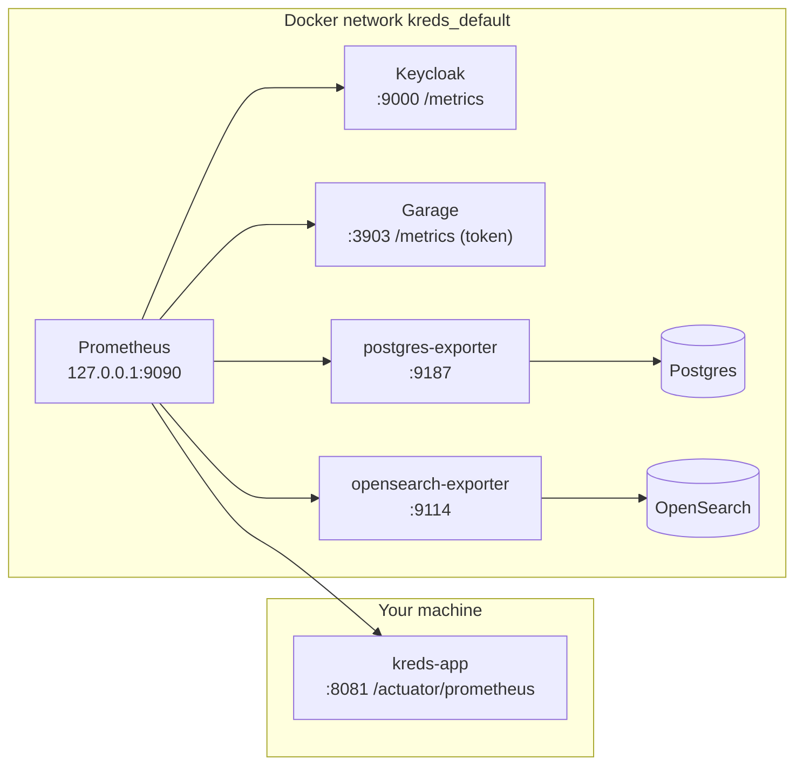

# Monitoring

How Kreds watches itself: metrics, health and (later) logs and alerts – **without ever seeing what users share**.
Decisions: ADR-0003 (Prometheus for metrics, Grafana for dashboards and alerts) and ADR-0004 (Loki for logs).
Logs: see [log-inventory.md](log-inventory.md).

## Overview



Prometheus **pulls** ("scrapes") every 30 seconds and keeps metrics for 15 days.

| Job          | Target                                          | Reachable from                                               | Access                                                                   |
|--------------|-------------------------------------------------|--------------------------------------------------------------|--------------------------------------------------------------------------|
| `prometheus` | `localhost:9090`                                | `127.0.0.1:9090` on the host                                 | Local only                                                               |
| `keycloak`   | `keycloak:9000/metrics`                         | Docker network only (management port is **never** published) | –                                                                        |
| `garage`     | `garage:3903/metrics`                           | Docker network; admin port also on `127.0.0.1:3903`          | Bearer token `GARAGE_METRICS_TOKEN` (metrics only – not the admin token) |
| `postgres`   | `postgres-exporter:9187`                        | Docker network only                                          | Exporter logs in as role `monitoring`                                    |
| `opensearch` | `opensearch-exporter:9114`                      | Docker network only                                          | None yet (OpenSearch security is off locally)                            |
| `kreds-app`  | `host.docker.internal:8081/actuator/prometheus` | Management port of the app, bound to `127.0.0.1`             | None – the port is never public                                          |

## Starting and stopping

Monitoring lives in its own file, `docker-compose.monitoring.yml`, in the **same Compose project** (`name: kreds`),
so it shares the network with the services it watches.

```bash
# Everything
docker compose -f docker-compose.yml -f docker-compose.monitoring.yml up -d

# Kreds only (Compose then warns about "orphan containers" – harmless, never add --remove-orphans)
docker compose up -d

# Check the scrape config before (re)starting Prometheus
docker compose -f docker-compose.yml -f docker-compose.monitoring.yml run --rm --entrypoint promtool prometheus check config /etc/prometheus/prometheus.yml

# After changing prometheus.yml
docker compose -f docker-compose.yml -f docker-compose.monitoring.yml restart prometheus
```

> **Never use `docker compose down -v`** unless you want to wipe all data. `-v` deletes the volumes – Postgres,
> OpenSearch, Garage (including its layout, bucket and keys) and Prometheus.

Status page: `http://127.0.0.1:9090/targets` – every job must be **UP**.

## Secrets and roles

| Variable (`.env`)        | Used by                                                                           | Rights                                                                                          |
|--------------------------|-----------------------------------------------------------------------------------|-------------------------------------------------------------------------------------------------|
| `GARAGE_METRICS_TOKEN`   | Garage + Prometheus (as Compose secret, file `/run/secrets/garage_metrics_token`) | Only `/metrics` – cannot touch buckets or keys                                                  |
| `MONITORING_DB_PASSWORD` | Postgres role `monitoring` + postgres-exporter (Compose secret)                   | `pg_monitor`: statistics and settings; **no** `CONNECT` on the `kreds` and `keycloak` databases |

Secrets reach containers as **Compose secrets** (files under `/run/secrets/`), not as environment variables, so they
do not appear in `docker inspect`. No committed file contains a secret.

The role `monitoring` is created by `postgres/init/20-create-monitoring-role.sh` – automatically on the first start
of an empty volume. For an existing volume, run it once by hand (it is idempotent):

```bash
docker compose exec postgres bash /docker-entrypoint-initdb.d/20-create-monitoring-role.sh
```

## The Kreds app (Spring Boot Actuator)

- Actuator runs on its **own management port** (`KREDS_MANAGEMENT_PORT`, default `8081`), bound to
  `KREDS_MANAGEMENT_ADDRESS` (default `127.0.0.1`). The public API port `8080` serves no Actuator at all.
- Only `health` (including `health/liveness` and `health/readiness`) and `prometheus` are exposed and open without
  a token. Everything else under `/actuator` is denied (`ManagementSecurityConfig`) – `env` or `heapdump` could
  contain secrets.
- `ManagementEndpointsIT` proves all of this.
- **Linux:** `host.docker.internal` points to the Docker bridge, not to `127.0.0.1`. Start the app with
  `KREDS_MANAGEMENT_ADDRESS=172.17.0.1` (the `docker0` address – check with `ip addr show docker0`). On macOS,
  Docker Desktop forwards `host.docker.internal` to `127.0.0.1`, so the default works.
- Later, when the app runs in Compose, the target becomes `kreds-app:8081` and the port is not published at all.

## Privacy rules for metrics

The data classification applies to metrics too ("when in doubt, encrypt"):

1. **Labels never contain personal data** – no user IDs, *kreds* IDs, email addresses, IPs or paths. Keycloak's
   login events are labelled only by realm, client, event and error (`KC_EVENT_METRICS_USER_TAGS=realm,clientId`).
2. **Index names never contain personal or *kreds*-specific data** (never `places-<circleId>`). They become label
   values in Prometheus.
3. **Spring metrics use URI templates** (`/api/v1/circles/{id}`), never real IDs, as tags.
4. Bruno checks enforce rule 1 for Keycloak, Garage, Postgres and OpenSearch (allow-list of label names, no `@` in
   label values).

## Checks (Bruno)

| Request                                              | What it proves                                                      |
|------------------------------------------------------|---------------------------------------------------------------------|
| `GET :9090/api/v1/targets`                           | All expected jobs exist and are `up`                                |
| `query=keycloak_user_events_total`                   | Login events are counted; label names only from the allow-list      |
| `GET :3903/metrics` (no token)                       | Garage refuses metrics without the token (`401`/`403`)              |
| `query={job="garage"}`                               | No `@` in any label value                                           |
| `query=pg_up`                                        | The exporter can really log in to Postgres (`"1"`)                  |
| `query=elasticsearch_cluster_health_number_of_nodes` | The exporter really reaches OpenSearch                              |
| `query=elasticsearch_cluster_health_status`          | Cluster is not red (picked by the `color` label, never by position) |

## Good to know

- **Keycloak login counters appear only after the first login** since Keycloak started. Until then the query is
  empty – expected, not a bug.
- **A target can be `up` while the service behind it is broken.** Exporters keep running when they cannot reach
  their database. That is why `pg_up` and the OpenSearch metrics are checked separately.
- **OpenSearch is yellow on a single node** when indices have replicas – normal locally. Red means act.
- **`busybox` tools in the Prometheus image** (`wget`, `nslookup`) can fail to resolve container names when the host
  has a search domain (e.g. `.home`). Prometheus itself is not affected – test through Prometheus or Bruno instead.
- **`pg_monitor` can read the text of running queries** (`pg_stat_activity`). Accepted: the exporter does not export
  query text by default, Kreds uses bind parameters (`$1`), and the exporter is reachable only inside Docker.
- `sslmode=disable` between the exporter and Postgres is acceptable only while both run on the same Docker network.

## Before any server

- OpenSearch security on → the opensearch-exporter gets its own read-only monitoring user.
- Postgres on its own server → TLS (`sslmode=verify-full`) for the exporter.
- Prometheus, exporters and (later) Loki stay on the internal network; only Grafana gets a login.
