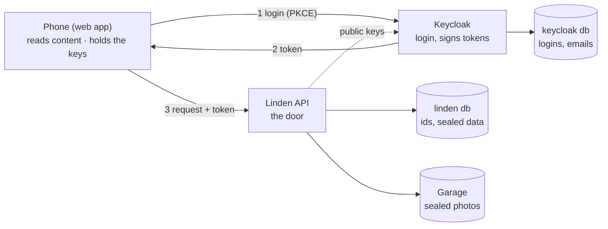

# Security

Every security rule of Linden in one place – what it is, why it exists, where it lives in the code and what proves
it. The detail stays in the linked docs and decisions; this page is the map.

**Words:** the code and these docs say *circle* and *post*; the app shows them as *kreds* and *glimt*.

**Keep it current:** a pull request that changes anything security-relevant updates this page in the same pull
request (the pull request template asks).

## Contents

1. [How to read this page](#1-how-to-read-this-page)
2. [The big picture](#2-the-big-picture)
3. [Identity and login](#3-identity-and-login)
4. [The API door](#4-the-api-door)
5. [Errors](#5-errors)
6. [The database](#6-the-database)
7. [Encryption](#7-encryption)
8. [Secrets](#8-secrets)
9. [Logs and monitoring](#9-logs-and-monitoring)
10. [Supply chain](#10-supply-chain)
11. [Open points](#11-open-points)

---

## 1. How to read this page

Every rule is one table row with the same five questions:

| Column           | Answers                                                                   |
|------------------|---------------------------------------------------------------------------|
| **Rule**         | What is true                                                              |
| **Why**          | What it protects against                                                  |
| **Where**        | The file or setting that makes it true                                    |
| **Protected by** | The test or check that turns red if the rule breaks – or *review* if none |
| **Decided in**   | The decision record (ADR) or principle it comes from                      |

A rule without a test is a wish. Where *Protected by* says *review*, a person has to check it in the pull request.

---

## 2. The big picture

Only the phone can read content. Everything on the server side sees **who, when and which circle**, never **what**.

| Hop             | What travels                                                        | What protects it                                                                      |
|-----------------|---------------------------------------------------------------------|---------------------------------------------------------------------------------------|
| 1–2 Login       | The password goes to Keycloak only; a signed token comes back       | PKCE – a stolen login code is useless; the API never sees a password                  |
| 3 Request       | The token, later a sealed post                                   | The API door ([section 4](#4-the-api-door))                                           |
| Public keys     | Keycloak's public signing keys                                      | The API checks tokens itself, without asking Keycloak on every request                |
| API → linden db | User ids (the `sub`), later sealed payloads + circle, author, time | Own database and role; no content, no names, no emails ([section 6](#6-the-database)) |
| API → Garage    | Sealed photos (not built yet)                                       | Only opaque blobs, never readable images                                              |

Details: [auth-flow.md](architecture/auth-flow.md), [encryption-flow.md](architecture/encryption-flow.md).

---

## 3. Identity and login

Keycloak knows who you are; Linden knows which circles you are in. The only link between the two is the `sub`
claim – a random, stable id Keycloak gives every account.

| Rule                                                                                                         | Why                                                                   | Where                                                                               | Protected by             | Decided in           |
|--------------------------------------------------------------------------------------------------------------|-----------------------------------------------------------------------|-------------------------------------------------------------------------------------|--------------------------|----------------------|
| Keycloak does identity only – no circles, no roles for content                                              | One system per job; membership lives next to the data it protects     | `keycloak/realm/linden-realm.json`, `auth-flow.md`                                  | review                   | ADR-0002             |
| Login with **Authorization Code + PKCE** (S256); public client `linden-web`, no client secret in the browser | A browser can't keep a secret; PKCE makes a stolen login code useless | realm file: `pkce.code.challenge.method=S256`, implicit flow and password grant off | Bruno login flow         | ADR-0002             |
| **No self-registration** – accounts only by invitation                                                       | A private app for family and friends                                  | realm file: `registrationAllowed: false`                                            | review                   | `VISION.md`          |
| Passwords: at least 12 characters, not the username or email; brute-force protection on                      | Guessing attacks                                                      | realm file: `passwordPolicy`, `bruteForceProtected`                                 | review                   | ADR-0002             |
| Access tokens live **5 minutes**                                                                             | A leaked token is useless soon                                        | realm file: `accessTokenLifespan: 300`                                              | review                   | ADR-0002             |
| The `sub` is the only thing copied from Keycloak – never a name, email or password                           | Data minimisation; the app database holds no personal data            | `app_user` (only `id` + `created_at`)                                               | `SchemaClassificationIT` | ADR-0002             |
| Test users use `example.com` addresses                                                                       | Never real personal data in tests or logs                             | `docs/local-setup.md`                                                               | review                   | `ENGINEERING.md` § 2 |

---

## 4. The API door

Every request passes Spring Security before any controller runs. The door decides; controllers can trust what got
through.

| Rule                                                                                                                                      | Why                                                                                                                                | Where                                                | Protected by                                                                                                      | Decided in           |
|-------------------------------------------------------------------------------------------------------------------------------------------|------------------------------------------------------------------------------------------------------------------------------------|------------------------------------------------------|-------------------------------------------------------------------------------------------------------------------|----------------------|
| **Deny by default** – every endpoint needs a valid token unless opened on purpose                                                         | Nothing is public by accident                                                                                                      | `SecurityConfig`                                     | `MeControllerTest.me_withoutToken_returns401`                                                                     | `ENGINEERING.md` § 1 |
| A token is valid only with Keycloak's **signature**, our **issuer** (realm `linden`) and our **audience** (`linden-api`), and not expired | Tokens from other realms, other apps or forgers are refused                                                                        | `application.properties` (`issuer-uri`, `audiences`) | Bruno `GET /api/v1/me`                                                                                            | ADR-0002             |
| The `sub` must be a **lowercase UUID** – otherwise `401 invalid_token` before any controller                                              | It is our user id; Java's `UUID.fromString` also accepts `1-2-3-4-5` and uppercase, so two different strings could become one user | `UuidSubjectAuthenticationConverter`                 | `SecurityConfigTest` (`nonUuidSubject_isRejected`, `missingSubject_isRejected`, control `uuidSubject_isAccepted`) | PR #40               |
| A rejected `sub` is logged as a WARN line **without its value**                                                                           | A federated `sub` can contain a username; the line still tells an admin the realm is misconfigured                                 | `UuidSubjectAuthenticationConverter`                 | review                                                                                                            | `ENGINEERING.md` § 7 |
| **Stateless**: no sessions, no cookies – and therefore no CSRF protection needed                                                          | CSRF abuses cookies the browser sends by itself; without cookies there is nothing to abuse                                         | `SecurityConfig`                                     | `MeControllerTest.me_withoutToken_createsNoSession`, Bruno "no session cookie"                                    | ADR-0002             |
| No user id in URLs – identity comes only from the token                                                                                   | Nobody can ask for someone else's data by changing a URL                                                                           | `MeController` (`/api/v1/me`)                        | review                                                                                                            | ADR-0002             |
| Actuator only on its own management port (`8081`, `127.0.0.1`); only `health` and `prometheus`, everything else denied                    | `env` or `heapdump` can contain secrets                                                                                            | `ManagementSecurityConfig`, `application.properties` | `ManagementEndpointsIT`                                                                                           | ADR-0003             |
| Membership is checked on **every** circle request – being logged in is not enough | Being logged in is not the same as being in a circle | `CircleService.getMembership` / `getCircle`; the list query only finds circles with a membership row | `CircleServiceIT` (`getCircle_asNonMember_throwsNotAMember`), `CircleControllerTest`, Bruno `Circles` | ADR-0002 |
| A circle you are not in looks **exactly** like one that does not exist: `404 circle_not_found` for both | Nobody learns which circle ids exist by trying them | `NotAMemberException`, `ApiExceptionHandler.handleNotAMember` | `CircleServiceIT.getCircle_thatDoesNotExist_throwsNotAMember`, `CircleControllerTest.get_whenNotAMember_returns404`, Bruno | PR #42 |
| **Leave at any time; only the owner removes members.** A member who is not the owner gets `403 not_circle_owner`; removing yourself is refused with `409 use_leave_instead` (leaving has its own rules); a removed member loses access on their next request | Self-protection without moderation – membership lives in Postgres, not in the token, so removal takes effect at once | `CircleService.leaveCircle` / `removeMember`, `DELETE …/members/me`, `DELETE …/members/{memberId}` | `CircleServiceIT` (`leaveCircle_…`, `removeMember_…`), `CircleControllerTest` (`leave_…`, `remove_…`), Bruno `Circles` | `VISION.md` § 5, decided 2026-11-25 |
| Request bodies are validated **at the edge**: a circle payload must be present and 1 to 4096 bytes, before anything reaches the service | Bad input is the client's mistake (`400`), never a `500`; nothing invalid is stored | `CreateCircleRequest` (`@NotNull`, `@Size`), `Circle` constructor, database `CHECK` | `CircleControllerTest` (`create_with…_returns400`), `CircleTest` | `ENGINEERING.md` § 1 |

---

## 5. Errors

| Rule                                                                                                 | Why                                                                           | Where                                           | Protected by                                                                                                       | Decided in           |
|------------------------------------------------------------------------------------------------------|-------------------------------------------------------------------------------|-------------------------------------------------|--------------------------------------------------------------------------------------------------------------------|----------------------|
| Every error is **Problem Details** (RFC 9457) with a stable `code` and the request's `correlationId` | One shape for the app; a user's "it failed at 14:02" can be found in the logs | `ApiExceptionHandler`, `CorrelationIdFilter`    | `ApiExceptionHandlerTest`                                                                                          | `ENGINEERING.md` § 7 |
| Validation errors name the **field and the reason** – never the rejected value | The client can fix the request; content is never echoed back | `ApiExceptionHandler.handleMethodArgumentNotValid` | `CircleControllerTest.create_withEmptyPayload_returns400NamingTheField` | `ENGINEERING.md` § 7 |
| **No internals** in responses – no stack traces, SQL, hostnames or exception messages                | Internals help attackers                                                      | `ApiExceptionHandler`                           | `ApiExceptionHandlerTest`, `MeControllerTest` (`INTERNAL` never in the body)                                       | `ENGINEERING.md` § 7 |
| A client-sent correlation id is used only if it is short and only letters, digits and hyphens        | Anything else could forge log lines                                           | `CorrelationIdFilter`                           | `CorrelationIdFilterTest`                                                                                          | `ENGINEERING.md` § 7 |
| Database unreachable → `503 service_unavailable`; any other database error stays `500`               | "Try again in a moment" only when it is true; bugs must not hide as outages   | `ApiExceptionHandler.handleDatabaseUnavailable` | `MeControllerTest.me_whenDatabaseUnavailable_returns503`, `me_whenDatabaseRejectsData_returns500`, Bruno `manual/` | PR #40               |
| Every call to the database has a **timeout** (3 s for a connection, 30 s for an answer)              | A hanging database must not hang the app                                      | `application.properties` (Hikari, driver)       | Bruno `manual/` with a paused database                                                                             | `ENGINEERING.md` § 7 |

---

## 6. The database

| Rule                                                                                                                                                   | Why                                                     | Where                                                         | Protected by                                                                     | Decided in            |
|--------------------------------------------------------------------------------------------------------------------------------------------------------|---------------------------------------------------------|---------------------------------------------------------------|----------------------------------------------------------------------------------|-----------------------|
| **One database and one login role per app** (`linden`, `keycloak`); neither can connect to the other's database; no app role is a superuser            | A bug or leak in one app can't read the other's data    | `postgres/init/10-create-databases.sh`                        | review                                                                           | ADR-0002              |
| The monitoring role reads statistics only – no `CONNECT` on the app databases                                                                          | Monitoring must never see data                          | `postgres/init/20-create-monitoring-role.sh`                  | review                                                                           | ADR-0003              |
| **No readable content in the database** – every column is on an allow list as `metadata` (with a reason) or `encrypted`; there is no level for content | The server must never be able to read what people share | `linden-core/src/test/resources/schema-classification.csv`    | `SchemaClassificationIT`, step **"No content in the database"** in Project rules | `VISION.md` § 5       |
| The schema only changes through **Flyway migrations**; Hibernate only validates                                                                        | Every change is reviewed and versioned                  | `db/migration`, `ddl-auto=validate`                           | `LindenApplicationIT`                                                            | `ENGINEERING.md` § 10 |
| A user is created once, even when several first requests arrive together                                                                               | No duplicate or half-created users                      | `AppUserRepository.insertIfAbsent` (`ON CONFLICT DO NOTHING`) | `AppUserServiceIT`                                                               | PR #40                |
| A circle name is stored only as an opaque `payload` (`encrypted` in the classification) – the server never reads, sorts, searches or notifies by it | Names like "Divorce support" reveal relationships | `circle.payload` (`V2`), `schema-classification.csv` | `SchemaClassificationIT` | decided 2026-11-25 |
| Deleting a circle removes its memberships, never users; a circle never exists without its owner | No orphans, no lost accounts | `V2` (`ON DELETE CASCADE`), `CircleService.createCircle` (one transaction) | `CircleMemberRepositoryIT.deleteCircle_removesItsMemberships_keepsUsersAndOtherCircles`, `CircleServiceIT` | PR #42 |
| A circle always has an owner: when the owner leaves, the **longest-standing member** takes over; when the **last member** leaves, the circle is deleted | No circle nobody can manage, no empty circle nobody can reach | `CircleService.leaveCircle`, `CircleMemberRepository.findOtherMembersLongestStandingFirst` | `CircleServiceIT.leaveCircle_asOwnerWithOthers_longestStandingMemberBecomesOwner`, `leaveCircle_asLastMember_deletesTheCircle` | decided 2026-11-25 |
| **Membership changes lock the circle's row** (`SELECT … FOR UPDATE`), so two changes to the same circle happen one after the other | Two members leaving at once could otherwise leave an empty circle, or fail half-way | `CircleService.lockCircle`, `CircleRepository.findByIdForUpdate` | `CircleServiceIT.leaveCircle_lastTwoMembersAtTheSameMoment_deleteTheCircle` (20 rounds, two threads) | decided 2026-11-25 |
| Roles are stored as fixed lowercase text (`owner`, `member`) with a database `CHECK` – renaming the Java enum never changes stored data | A wrong role would give or take away the right to remove members | `CircleRole`, `CircleRoleConverter`, `V2` | `CircleMemberRepositoryIT.save_thenFindById_returnsTheRoleAndADatabaseTimestamp` | PR #42 |

What the test can't see: whether a column declared `encrypted` really holds ciphertext, and whether a `metadata`
column reveals too much. The pull request review asks *"does a new server-visible field reveal relationships?"*.

---

## 7. Encryption

End-to-end encryption with **MLS** (Messaging Layer Security), using `@wireapp/core-crypto` behind our own adapter.
**Status: proven in the Phase 1 spike, not in the app yet.**

| Rule                                                                                                                                                              | Why                                                         | Where                   | Protected by                            | Decided in         |
|-------------------------------------------------------------------------------------------------------------------------------------------------------------------|-------------------------------------------------------------|-------------------------|-----------------------------------------|--------------------|
| Never our own crypto – an established, audited MLS library                                                                                                        | Home-made crypto fails                                      | ADR-0001                | review                                  | ADR-0001           |
| Only the crypto adapter imports the MLS library                                                                                                                   | The library can be swapped without touching the app         | not built yet (web app) | planned: ESLint `no-restricted-imports` | ADR-0001           |
| **Fake lock first:** the first post is built shaped for encryption (opaque `payload` + metadata), sealed by a no-op adapter; real encryption replaces it later | See the data flow first – without building anything twice   | not built yet           | planned: the three guards below         | decided 2026-11-23 |
| Guard 1: a red **"NOT ENCRYPTED"** banner while the no-op adapter is active                                                                                       | Nobody mistakes it for the real thing                       | not built yet           | planned                                 | decided 2026-11-23 |
| Guard 2: the no-op adapter exists **only in local development builds**                                                                                            | It can never reach a real user                              | not built yet           | planned                                 | decided 2026-11-23 |
| Guard 3: a Project rules check **fails any production build that contains it**                                                                                    | The machine remembers guard 2                               | not built yet           | planned                                 | decided 2026-11-23 |
| Every payload starts with a **format version** (`0` = fake lock)                                                                                                  | Fake-lock data can be told apart and removed after the swap | not built yet           | planned                                 | decided 2026-11-23 |
| History backup (ADR-0005) is in place **before** the first real key                                                                                               | A wiped browser must never mean lost photos                 | not designed yet        | –                                       | decided 2026-11-23 |

Details: [encryption-flow.md](architecture/encryption-flow.md).

---

## 8. Secrets

| Rule                                                                                                                     | Why                                                                        | Where                                                  | Protected by                                                            | Decided in           |
|--------------------------------------------------------------------------------------------------------------------------|----------------------------------------------------------------------------|--------------------------------------------------------|-------------------------------------------------------------------------|----------------------|
| **No secret in Git** – real values only in `.env` (ignored); `.env.example` holds placeholders                           | The repository is public                                                   | `.gitignore`, `.env.example`                           | gitleaks, step **"No secrets in Git"** in Project rules (whole history) | `ENGINEERING.md` § 1 |
| A leaked secret is **rotated first** – deleting it from Git does not help                                                | Once public, always public                                                 | [project-rules.md](project-rules.md)                   | review                                                                  | `ENGINEERING.md` § 1 |
| IntelliJ run configurations stay local – never *Store as project file*; `.run/` and `.idea/` are ignored as a safety net | Run configurations hold environment variables such as `LINDEN_DB_PASSWORD` | `.gitignore`                                           | `git check-ignore` (break check)                                        | PR for this page     |
| Credentials in Bruno are **secret variables**, never in request files                                                    | The Bruno collection is committed                                          | `bruno/linden/`                                        | gitleaks                                                                | `ENGINEERING.md` § 1 |
| Secrets reach containers as **Compose secrets** (files), not environment variables, where the image supports it          | They don't show up in `docker inspect`                                     | `docker-compose*.yml`                                  | review                                                                  | ADR-0003             |
| Garage: the app's key only works on its own bucket; the metrics token can't touch buckets                                | Least privilege                                                            | `docs/local-setup.md`, `docs/operations/monitoring.md` | Bruno (Garage refuses metrics without token)                            | `ENGINEERING.md` § 1 |
| Never paste tokens into online JWT decoders, never real secrets into chats                                               | A token is a key to the account                                            | `docs/local-setup.md`                                  | review                                                                  | `ENGINEERING.md` § 1 |

---

## 9. Logs and monitoring

| Rule                                                                                                                                          | Why                                                | Where                                              | Protected by                                                     | Decided in           |
|-----------------------------------------------------------------------------------------------------------------------------------------------|----------------------------------------------------|----------------------------------------------------|------------------------------------------------------------------|----------------------|
| Logs never contain content, keys, tokens, passwords or email addresses                                                                        | Logs are read by people and kept for days          | `ENGINEERING.md` § 2                               | Fluent Bit redaction test `run-redact-test.sh`, Bruno log checks | ADR-0004             |
| Fluent Bit is the one filter point: an allow list of services; Keycloak usernames and IPs and Postgres `STATEMENT`/`DETAIL` lines are removed | Keycloak and Postgres log personal data by default | `monitoring/fluent-bit/`                           | `run-redact-test.sh` (fake data only)                            | ADR-0004             |
| Metric labels never contain personal data – no user ids, circle ids, emails, IPs or paths                                                    | Metrics are kept and graphed                       | `docs/operations/monitoring.md`                    | Bruno label checks                                               | ADR-0003             |
| Every local service listens on `127.0.0.1` only                                                                                               | Nothing is reachable from the network by accident  | `docker-compose*.yml` (`127.0.0.1:` port bindings) | review                                                           | `ENGINEERING.md` § 1 |
| Grafana: no anonymous access, no sign-up, no phoning home; Loki has no port                                                                   | Monitoring is for the owner only                   | `docker-compose.monitoring.yml`                    | Bruno Grafana checks                                             | ADR-0003, ADR-0004   |

Details: [log-inventory.md](operations/log-inventory.md), [monitoring.md](operations/monitoring.md).

---

## 10. Supply chain

| Rule                                                                                      | Why                                              | Where                                      | Protected by                                       | Decided in            |
|-------------------------------------------------------------------------------------------|--------------------------------------------------|--------------------------------------------|----------------------------------------------------|-----------------------|
| Docker images pinned to `MAJOR.MINOR.PATCH` – never `latest`, `rc` or `beta`              | Builds don't change under our feet               | `docker-compose*.yml`, test configurations | review – planned: image-pin check in Project rules | `ENGINEERING.md` § 10 |
| The gitleaks image is pinned by tag **and digest**                                        | A moved tag can't swap the scanner               | `.github/workflows/rules.yml`              | review                                             | PR #36                |
| Dependabot proposes updates weekly (Maven, Actions, Docker); they are merged deliberately | Known fixes arrive quickly, but never unreviewed | `.github/dependabot.yml`                   | CI on every Dependabot pull request                | `ENGINEERING.md` § 1  |
| `main` only through pull requests with green **build** and **Project rules**; no bypass   | Nothing unchecked reaches `main`                 | ruleset `protect-main`                     | GitHub                                             | `ENGINEERING.md` § 10 |

---

## 11. Open points

What is **not** protected yet. Before real users arrive, unfixed weaknesses move out of this public page, and a
`SECURITY.md` explains how to report a vulnerability.

| Open point                                                                                     | Planned                                        |
|------------------------------------------------------------------------------------------------|------------------------------------------------|
| Request body size limit – Spring reads the whole body before validation | Before going public, with rate limiting |
| Duplicate creates from a double tap or an automatic retry (idempotency key) | With the web app's first write |
| Encryption in the app – no post exists yet; the fake lock comes first                       | Prototype path (section 7)                     |
| History backup design (ADR-0005), message format (ADR-0008)                                    | Before the swap to real encryption             |
| Rate limiting on login, invitations and uploads                                                | Before going public                            |
| Keycloak runs in development mode (`start-dev`, HTTP, bootstrap admin)                         | Before any server                              |
| The login page heading shows the code name (realm `displayName`)                               | Undecided                                      |
| Image-pin check; the Postgres version sits in three places (Compose + two test configurations) | With the app's Dockerfile (Monitoring Step 6b) |
| Licence check and dependency vulnerability audit in Project rules                              | Before the family alpha                        |
| Encrypted server backups with a tested restore                                                 | Before the family alpha                        |
| `SECURITY.md` and an external security review                                                  | Before going public                            |
